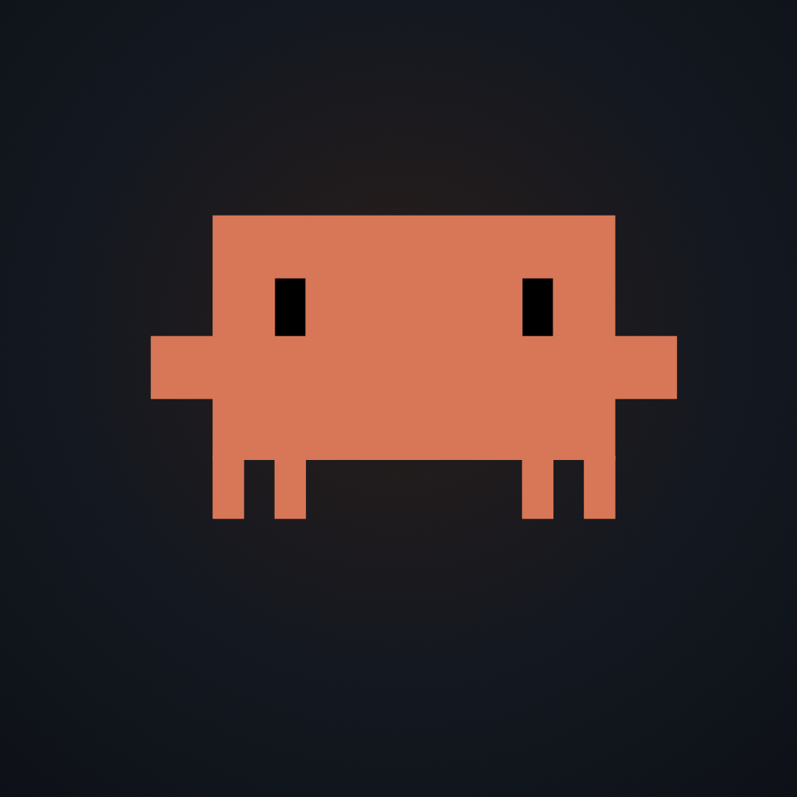
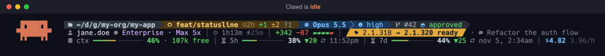
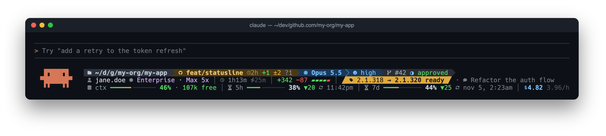

<div align="center">



# clawdline

**The status bar Claude Code deserves.**<br>
Clawd lives in it. Your PR's CI status glows in it. Your quotas stop taking you by surprise.

[](https://github.com/mmurdockk/claude-statusline/releases)
[](https://github.com/mmurdockk/claude-statusline/actions/workflows/ci.yml)
[](#-install)
[](#-github--gitlab-pr-and-live-ci)
[](LICENSE)



</div>

## ✨ Highlights

### 🦀 Clawd, alive in your terminal

Clawd, the Claude Code mascot, reacts to what Claude is doing, second by second. He **ponders** while the model
thinks, **walks** while a tool runs, **dances** the moment you commit, **dozes off** when you step away, and
**sweats** as you get close to a limit. His colour doubles as the bar's warning light: terracotta while all is
well, amber past 50 %, red past 80 %.

### 🔀 GitHub & GitLab: PR and live CI

Your open **pull request** (`#42`) or **merge request** (`!42`) sits right next to the model, with its review
state (`approved`, `changes`, `draft`) and its **CI status, live**:

| `✓` passed | `✗` failed | `◐` running | `◌` pending | `▶` manual | `⊘` canceled / skipped |
|---|---|---|---|---|---|

No PR yet? You still see the latest workflow run or pipeline of your branch. GitHub goes through `gh`, GitLab
(gitlab.com or self-hosted) through `glab`. Both are queried in the background, so the bar never waits on the network.

### 📊 Know what you have left

Context window, 5-hour and 7-day quotas as gauges, each with its **pace**: `▲12` means you are burning the quota
12 points faster than it refills, `▼20` means you are coasting. Plus the session cost and its hourly burn rate.

### ⚡ No runtime to install

Plain POSIX `sh` and `jq`: no Node, no Python, no binary to download. About two processes per render, overlapped,
because it runs every second.

## 🚀 Install

**From your terminal**, in one step:

```bash
claude plugin install clawdline --marketplace mmurdockk/claude-statusline
```

**Or inside Claude Code:**

```
/plugin marketplace add mmurdockk/claude-statusline
/plugin install clawdline@clawdline
```

Then, in a Claude Code session, run **`/reload-plugins`** (if the plugin was installed during that session) and
**`/clawdline:setup`**, which points your status line at clawdline. That's it.

You need `jq` and a [Nerd Font](https://www.nerdfonts.com/) in your terminal
(`brew install jq && brew install --cask font-hack-nerd-font`). For the CI status, have `gh` and/or `glab` installed and logged in.

<details>
<summary><b>Without the plugin system</b> (one curl, hooks written to <code>settings.json</code>)</summary>

```bash
curl -fsSL https://raw.githubusercontent.com/mmurdockk/claude-statusline/main/install.sh | sh
```

It clones the repo into `~/.claude/claude-statusline` and wires the status line and its hooks into
`~/.claude/settings.json` (backed up first). Update with `git -C ~/.claude/claude-statusline pull`,
remove with `~/.claude/claude-statusline/install.sh --uninstall`.
</details>

<details>
<summary><b>Update / uninstall the plugin</b></summary>

- **Update:** `/plugin`, then **Marketplaces → clawdline → Enable auto-update**, or by hand:
  `claude plugin marketplace update clawdline && claude plugin update clawdline@clawdline`. No need to run setup again.
- **Uninstall:** run `/clawdline:uninstall` first, which removes the status line from your settings, then
  `/plugin uninstall clawdline@clawdline`.
</details>

## 🖥️ What's on screen



1. **Where and what:** directory · branch with its state (the segment turns violet when clean, amber when dirty,
   red during a conflict), age of the last commit, staged / modified / untracked counts · model, effort, fast mode ·
   what Claude is doing right now (`Bash 14s`) · PR / MR with CI and review.
2. **This session:** account and plan · elapsed time vs. time waiting on the API · lines added and removed ·
   Claude Code version, with `→ x.y.z ready` when an update is waiting · session name.
3. **What's left:** context, 5h and 7d gauges with pace and reset times · cost and burn rate. Any figure at 90 % or more blinks.

<details>
<summary><b>⚙️ Configuration</b></summary>

Everything is optional. Set these in `~/.claude/settings.json` under `"env"`, e.g. `"env": { "SL_NERD": "0" }`.

| Variable | Default | Effect |
|---|---|---|
| `SL_NERD` | `1` | `0` = ASCII fallback, for terminals without a Nerd Font |
| `SL_POWERLINE` | `1` | `0` = thin `│` dividers instead of filled arrow segments |
| `SL_MASCOT` | `1` | `0` = no Clawd |
| `SL_PATH` | `short` | `full` = don't abbreviate parent directories |
| `SL_ACCOUNT` | `1` | `0` = hide the account, `org` = also show the organisation |
| `SL_FORGE` | `1` | `0` = no CI lookup through `gh` / `glab` (the PR/MR number still shows: Claude Code provides it) |
| `SL_TRACK` | `54,61,72` | RGB of the empty part of the gauges; pick something darker than your background on a light theme |
</details>

<details>
<summary><b>🩺 Troubleshooting</b></summary>

| Symptom | Fix |
|---|---|
| Boxes or `?` instead of icons | Your terminal isn't using a Nerd Font: install one and select it, or set `SL_NERD=0` |
| Nothing shows | Run `/clawdline:setup` again; check `statusLine` in `~/.claude/settings.json` |
| Clawd's rows look misaligned | Use the *Mono* variant of your Nerd Font (e.g. *Hack Nerd Font Mono*) |
| No PR / MR number | Claude Code only sends it while a PR / MR is *open* for the current branch |
| No CI status | `gh auth status` / `glab auth status`; the `origin` remote must point to GitHub, or to a GitLab host with `gitlab` in its name |
| `gh auth` / `glab auth` in amber | Your token expired: log in again |
</details>

<details>
<summary><b>🔧 How it works</b></summary>

Claude Code pipes a JSON payload into `statusline.sh` every second. A single `jq` pass (`statusline.jq`) parses it and
does all the maths while `git status` runs in parallel; everything else is shell builtins. Hooks
(`statusline-turn.sh`) record what the turn is doing, which the payload alone cannot tell. PR / MR numbers and review
states come from the payload for free; CI status comes from a detached `gh` / `glab` job, at most once a minute,
whose result the render reads from a cache. The plugin's `SessionStart` hook keeps
`~/.claude/plugins/clawdline/current` pointed at the installed version, so updates need no new setup.
</details>

## 🤝 Contributing

Issues and pull requests are welcome. `tools/test.sh` runs the test suite (CI runs it on Linux and macOS),
`tools/demo.sh [tool|think|idle|asleep|party]` renders the bar with fake data, and `uv run tools/animate.py` /
`uv run tools/screenshot.py` regenerate the images. A release is just a tag: bump `version` in
`.claude-plugin/plugin.json` and `marketplace.json`, then `git tag vX.Y.Z && git push origin vX.Y.Z`.

MIT licensed. Made by [Adrien Gooris](https://github.com/mmurdockk).
